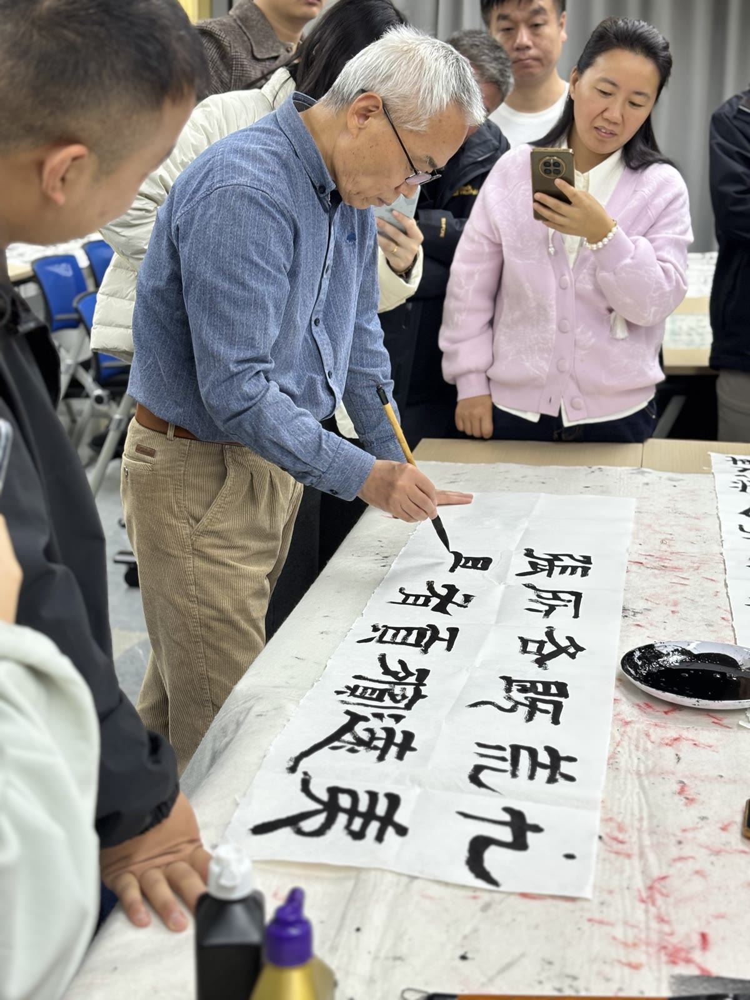
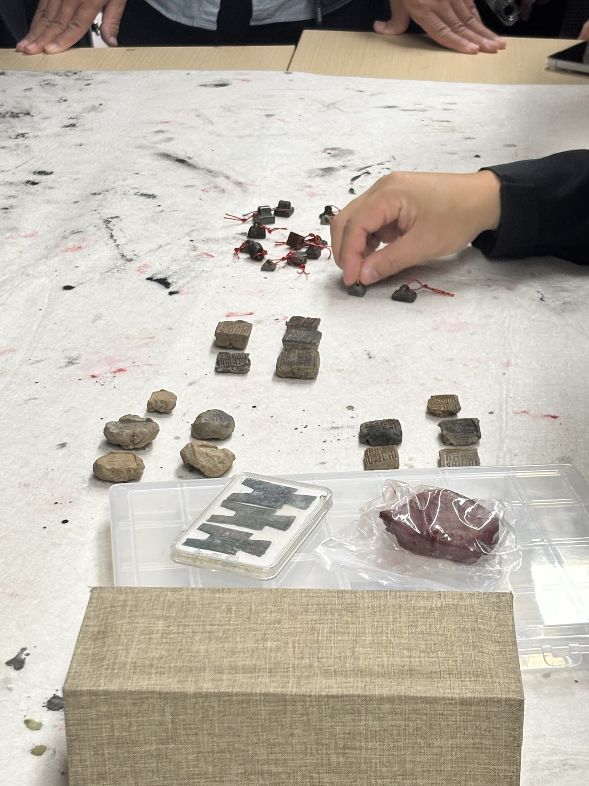
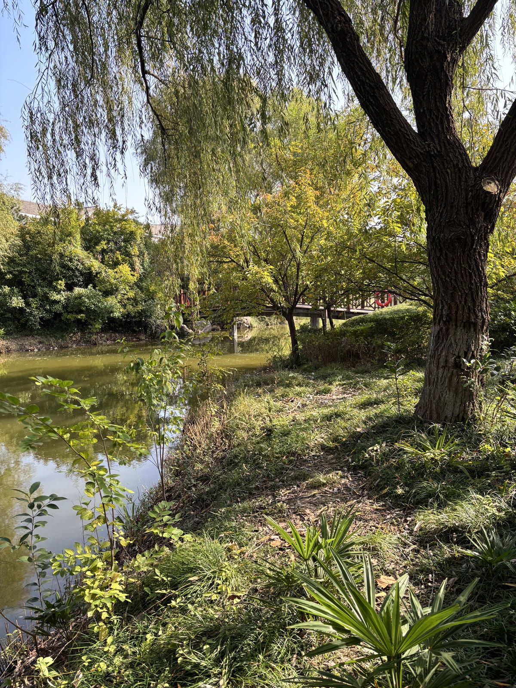

+++
title = '写了一个中午，去上了三天书法课'
date = 2026-11-06
draft = true
slug = 'three-days-of-calligraphy'
description = '一个中午写出来的参赛作品，三天书法课，还有一张午饭后拍的校园照。'
categories = ['生活']
tags = ['随笔', '书法']
+++

公司征集书法作品，我花了一个中午写出一幅交上去，得了个三等奖。

我小时候练过字，现在一年也写不了几次。以前公司征集作品，我也交过，没轮到我去培训。可能是写得太烂了，我自己瞎猜的。这次倒是去了，参加的是公司第三届书法爱好者培训。10 月 27 日开班，一共三天。

隶书老师讲起参赛，话说得挺直。楷书、行书写出来好看，这个大家都知道。写的人太多了，也容易显得俗气。真要得奖，他觉得还得是隶书。

翻笔记的时候，我看到自己画了一串箭头，把隶、楷、行、草连了起来，每个箭头上都写着一个「快」，末尾打了个叉。底下另记了一句，行、楷、草各有各的用处。还有位老师看了我的字，说我写得太少，要多写，写的时候墨也少蘸一点。

篆刻老师拿了些古董给我们看，里头还有汉代的私印。他研究过这些古董上的铭文，也凭这方面的研究拿过兰亭奖。照片里，带着墨点的白布上摆着几枚系了红绳的小印，旁边还有几块边缘不齐、上头带字的残片。我在本子上记了两个新词，「金石学」和「印屏」。

学校里挺好看的。中午吃完饭，我在水边拍了张照片。柳枝垂下来，树叶后面露着半截小桥。

回来以后，我大概还是不会在写字上下太多功夫。也许等我老了，我就去写字去。
